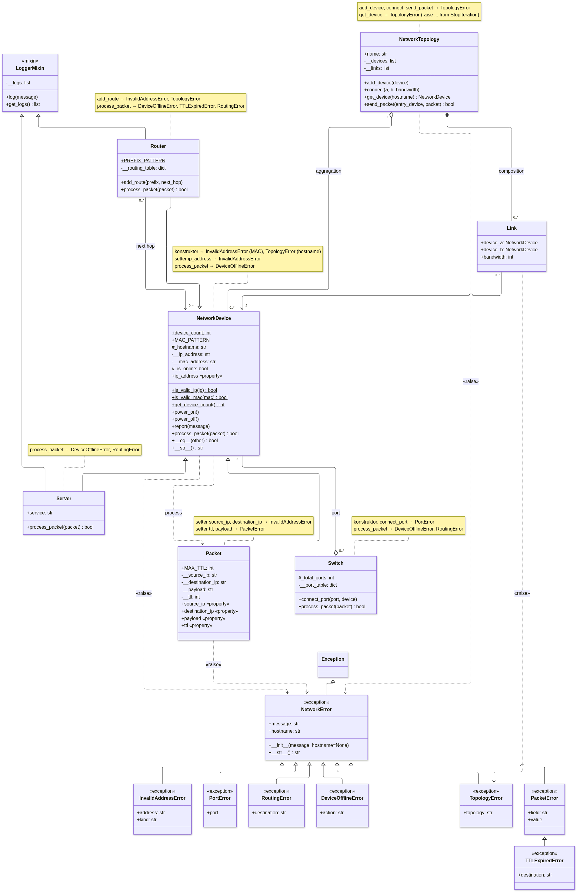

# Simulasi Jaringan Komputer — Exception Handling

Tugas P9 Pemrograman Berorientasi Objek (IF23U1411 PAGI2): melanjutkan proyek UTS
**Kasus 5 – Simulasi Jaringan Komputer (Network Topology & Traffic Manager)** dengan
menambahkan exception handling.

## Identitas

**Kelompok:** _(isi nomor kelompok sesuai LMS)_

| NIM        | Nama                     | Akun Git        |
|------------|--------------------------|-----------------|
| 2501020053 | I Putu Bala Krishna Dasa | balaqiang       |
| 2501020052 | I Putu Gede Swanjaya     | PetengSz        |
| 2501020062 | Dimas Raditya Putu Jati  | dimasradityaputujati |

## Deskripsi Sistem

Simulasi Jaringan Komputer dipakai oleh Administrator Jaringan untuk mengelola
infrastruktur perangkat jaringan, memantau status koneksi, dan mensimulasikan pengiriman paket
data antarperangkat dalam topologi LAN/WAN. Administrator mendaftarkan perangkat (Router, Switch,
Server), mengatur alamat IP, alamat MAC, dan bandwidth, lalu menghubungkan perangkat ke tabel
routing atau port switch. Paket berisi alamat pengirim, alamat penerima, dan payload. Router
meneruskan paket antarjaringan berdasarkan tabel routing, Switch meneruskan paket dalam satu
segmen ke port yang sesuai, dan Server menerima paket serta mencatat log trafik.

Asumsi (dari UTS, dengan pembaruan):

1. PC pada gambaran kasus diwakili oleh Server sebagai perangkat akhir.
2. Setiap perangkat memiliki satu alamat IP dan satu alamat MAC; MAC unik dalam satu topologi.
3. Tabel routing memakai awalan IP berupa teks, misalnya `"192.168.10."`.
4. TTL awal paket 64 dan berkurang 1 di setiap router. **Diperbarui:** paket yang tidak punya
   rute, TTL-nya habis, atau dikirim ke perangkat OFF tidak lagi menghasilkan `False` diam-diam,
   melainkan memunculkan exception.
5. **Baru:** perangkat baru berstatus ON setelah didaftarkan ke topologi (`add_device`).

## 1. Aturan Bisnis yang Dapat Dilanggar

| No | Aturan bisnis | Dicek di | Exception |
|----|---------------|----------|-----------|
| 1 | Alamat IP harus IPv4 valid (4 oktet, masing-masing 0–255); MAC harus berformat `XX:XX:XX:XX:XX:XX`; prefix routing berformat `angka.` (mis. `192.168.10.`) | setter `ip_address`, `Packet.source_ip/destination_ip`, `NetworkDevice.__init__`, `Router.add_route()` | `InvalidAddressError` |
| 2 | TTL paket harus bilangan bulat 0–255 dan payload tidak boleh kosong | setter `Packet.ttl`, `Packet.payload` | `PacketError` |
| 3 | Paket yang TTL-nya habis (menjadi 0) di router harus dibuang | `Router.process_packet()` | `TTLExpiredError` |
| 4 | Perangkat yang OFF tidak boleh memproses paket | `process_packet()` pada semua perangkat | `DeviceOfflineError` |
| 5 | Nomor port switch harus 1..`total_ports`, satu port hanya untuk satu perangkat, dan satu perangkat hanya di satu port | `Switch.__init__()`, `Switch.connect_port()` | `PortError` |
| 6 | Paket harus punya rute: prefix tujuan ada di tabel routing dan IP tujuan ada di tabel port switch | `Router/Switch/Server.process_packet()` | `RoutingError` |
| 7 | Bandwidth link harus > 0, perangkat tidak boleh dihubungkan ke dirinya sendiri, MAC/IP tidak boleh ganda dalam satu topologi, dan perangkat harus terdaftar sebelum dihubungkan atau dipakai mengirim paket | `Link.__init__()`, `NetworkTopology.add_device()/connect()/send_packet()` | `TopologyError` |

## 2. Daftar Custom Exception

Semua exception ada di [`src/exceptions.py`](src/exceptions.py). Setiap kelas punya `__init__`
dengan atribut konteks dan memanggil `super().__init__(pesan)` (rantai sampai ke `Exception`).
`NetworkError` adalah base exception, sehingga seluruh pelanggaran aturan bisnis dapat ditangkap
dengan satu `except NetworkError`.

```
Exception
└── NetworkError                (message, hostname)
    ├── InvalidAddressError     (address, kind)
    ├── PacketError             (field, value)
    │   └── TTLExpiredError     (destination)
    ├── DeviceOfflineError      (action)
    ├── PortError               (port)
    ├── RoutingError            (destination)
    └── TopologyError           (topology)
```

| Nama | Class induk | Atribut konteks | Kapan dimunculkan | Method yang memunculkan | Cara program menangani |
|------|-------------|-----------------|-------------------|-------------------------|------------------------|
| `NetworkError` | `Exception` | `message`, `hostname` | Base, tidak di-raise langsung | — | `except NetworkError` terakhir sebagai penangkap umum di `simulate_packets`, `run_rule_checks`, dan `main` |
| `InvalidAddressError` | `NetworkError` | `address`, `kind` | IP / MAC / prefix routing tidak valid | setter `ip_address`, `Packet.source_ip/destination_ip`, `NetworkDevice.__init__`, `Router.add_route` | Ditampilkan "Ditolak (alamat)"; nilai lama tetap dipakai |
| `PacketError` | `NetworkError` | `field`, `value` | TTL di luar 0–255 / bukan integer, payload kosong | setter `Packet.ttl`, `Packet.payload` | Ditampilkan "Ditolak (paket)"; paket tidak dibuat |
| `TTLExpiredError` | `PacketError` | `destination` | TTL habis saat diteruskan router | `Router.process_packet` | Ditangkap paling awal di `simulate_packets` sebagai "GAGAL [TTL]" |
| `DeviceOfflineError` | `NetworkError` | `action` | Perangkat OFF diminta memproses paket | `process_packet` (semua perangkat) | "GAGAL [OFFLINE]"; simulasi lanjut ke paket berikutnya |
| `PortError` | `NetworkError` | `port` | Port di luar 1..total, sudah dipakai, perangkat sudah tercolok, port bukan angka | `Switch.__init__`, `Switch.connect_port`, `parse_port` (`raise ... from ValueError`) | "Ditolak (port)" beserta penyebab aslinya |
| `RoutingError` | `NetworkError` | `destination` | Tidak ada prefix yang cocok / IP tidak ada di tabel port | `Router/Switch/Server.process_packet` | "GAGAL [ROUTING]"; pada paket kritis dicatat audit lalu di-re-raise ke `main` |
| `TopologyError` | `NetworkError` | `topology` | Bandwidth ≤ 0, link ke diri sendiri, MAC/IP ganda, perangkat belum terdaftar / tidak ditemukan | `Link.__init__`, `NetworkTopology.add_device/connect/send_packet/get_device`, `Router.add_route` | "Ditolak (topologi)"; `get_device` menyertakan penyebab `StopIteration` |

## 3. Class Diagram (Revisi)



Sumber diagram: [`docs/class-diagram.mmd`](docs/class-diagram.mmd) (Mermaid).

Perubahan dari class diagram UTS:

- Ditambahkan delapan class bertanda stereotype «exception» dengan relasi generalization ke
  `NetworkError`, dan `NetworkError` ke `Exception`; `TTLExpiredError` merupakan turunan `PacketError`.
- Catatan (note) kuning pada tiap class domain menunjukkan method/setter mana yang memunculkan
  exception apa; garis putus-putus «raise» adalah dependency ke exception.
- Atribut dan method baru: setter `source_ip`, `destination_ip`, `payload` pada `Packet`;
  `is_valid_mac()`, `MAC_PATTERN`, `power_off()` pada `NetworkDevice`; `PREFIX_PATTERN` pada
  `Router`; `get_device()` pada `NetworkTopology`. `send_packet()` kini mengembalikan `bool`.
- `LoggerMixin` diberi stereotype «mixin».

Notasi: `+` public, `#` protected, `-` private, garis bawah = class/static member, segitiga
kosong = generalization, belah ketupat hitam = composition, belah ketupat putih = aggregation,
panah = association, putus-putus = dependency.

## 4. Perubahan Setter dan Method (raise)

Kelas domain di [`src/models.py`](src/models.py) tidak lagi menolak data dengan `return False`
atau mengabaikannya, dan tidak mencetak pesan error; semua penolakan berupa `raise`.

| Kelas | Setter / method | Sebelum (UTS) | Sesudah |
|-------|-----------------|---------------|---------|
| `Packet` | `ttl` | `ValueError` | `PacketError` (juga menolak non-integer) |
| `Packet` | `source_ip`, `destination_ip`, `payload` | tanpa validasi | `InvalidAddressError` / `PacketError` |
| `NetworkDevice` | `ip_address` | `ValueError` | `InvalidAddressError` |
| `NetworkDevice` | `__init__` | MAC & hostname tidak dicek | `InvalidAddressError` / `TopologyError`; `device_count` hanya bertambah jika valid |
| `NetworkDevice` | `process_packet` | `return False` jika OFF | `DeviceOfflineError` |
| `Router` | `add_route` | tanpa validasi | `InvalidAddressError` / `TopologyError` |
| `Router` | `process_packet` | `return False` + print "tidak ada rute" | `TTLExpiredError`, `RoutingError` |
| `Switch` | `__init__`, `connect_port` | `ValueError` untuk port di luar jangkauan | `PortError` (jangkauan, port terpakai, perangkat ganda) |
| `Switch` | `process_packet` | `return False` | `DeviceOfflineError`, `RoutingError` |
| `Server` | `process_packet` | `return False` | `DeviceOfflineError`, `RoutingError` |
| `Link` | `__init__` | tanpa validasi | `TopologyError` |
| `NetworkTopology` | `add_device`, `connect`, `send_packet` | tanpa validasi | `TopologyError` |
| `NetworkTopology` | `get_device` (baru) | — | EAFP, `raise TopologyError(...) from StopIteration` |

## 5. Program Utama

[`src/main.py`](src/main.py) memakai `try / except / else / finally` di beberapa tempat:

| Bagian | Skenario | Teknik |
|--------|----------|--------|
| `simulate_packets()` | 1 paket berhasil, 4 gagal (tidak ada rute di R1, tidak ada di port SW1, BACKUP-01 OFF, TTL habis) | `except` dari spesifik ke umum: `TTLExpiredError` → `RoutingError` → `DeviceOfflineError` → `NetworkError`; `else` menghitung paket terkirim; `finally` menampilkan sisa TTL |
| `run_rule_checks()` | 10 pelanggaran aturan + 1 aksi valid | `InvalidAddressError` → `PacketError` → `PortError` → `TopologyError` → `NetworkError`; `else` hanya untuk aksi valid; `finally` menampilkan jumlah perangkat |
| `parse_port()` | Port dari konfigurasi teks `"dua"` | **EAFP** (`int()` langsung dicoba) + **`raise PortError(...) from ValueError`** |
| `NetworkTopology.get_device()` | Mencari `FW-01` yang tidak ada | **EAFP** + **`raise ... from StopIteration`** |
| `send_critical()` | Paket kritis ke `10.9.9.9` | **re-raise** (`raise` tanpa argumen) setelah mencatat audit, ditangkap lagi di `main()` |
| `main()` | Membungkus seluruh simulasi | `finally` selalu menutup simulasi |

Tidak ada `except:` kosong (bare except); setiap `except` menyebut class exception tertentu.

## Struktur Repository

```
.
├── README.md
├── docs/
│   ├── class-diagram.png     class diagram revisi
│   └── class-diagram.mmd     sumber Mermaid diagram
└── src/
    ├── exceptions.py         hierarki custom exception
    ├── models.py             class domain dari UTS
    ├── main.py               program utama
    └── test_models.py        unit test aturan bisnis
```

## Cara Menjalankan

Membutuhkan Python 3.8 atau lebih baru, tanpa library tambahan.

```bash
python src/main.py
```

Menjalankan unit test:

```bash
python -m unittest discover -s src -v
```

## Contoh Output

```
=== Simulasi Jaringan: LAN Kantor ===
Server WEB-01 (192.168.10.10) [ON]
Server BACKUP-01 (192.168.10.30) [OFF]
Jumlah perangkat: 5 

--- Bagian 1: Pengiriman paket ---
Kirim 10.0.0.5 -> 192.168.10.10
  R1: rute via SW1
  SW1: ke port 1 (MAC CC:CC:CC:00:00:10)
  WEB-01: paket diterima (HTTP)
  Hasil: TERKIRIM
  (TTL tersisa: 63)
Kirim 10.0.0.5 -> 172.16.0.9
  GAGAL [ROUTING] : [R1] tidak ada rute ke 172.16.0.9, paket dibuang
  (TTL tersisa: 63)
Kirim 10.0.0.5 -> 192.168.10.99
  R1: rute via SW1
  GAGAL [ROUTING] : [SW1] tidak ada rute ke 192.168.10.99, paket dibuang
  (TTL tersisa: 63)
Kirim 10.0.0.5 -> 192.168.10.30
  R1: rute via SW1
  SW1: ke port 3 (MAC CC:CC:CC:00:00:30)
  GAGAL [OFFLINE] : [BACKUP-01] perangkat OFF, tidak dapat memproses paket
  (TTL tersisa: 63)
Kirim 10.0.0.5 -> 192.168.10.20
  GAGAL [TTL]     : [R1] TTL paket ke 192.168.10.20 habis, paket dibuang
  (TTL tersisa: 0)
Ringkasan: 1 dari 5 paket terkirim

--- Bagian 2: Uji aturan bisnis ---
Uji: Ubah IP DB-01 menjadi 192.168.10.300
  Ditolak (alamat)  : [DB-01] Alamat IP tidak valid: '192.168.10.300'
  -> jumlah perangkat tercatat: 5
Uji: Buat Server dengan MAC 'zz:zz:zz'
  Ditolak (alamat)  : [WEB-03] Alamat MAC tidak valid: 'zz:zz:zz'
  -> jumlah perangkat tercatat: 5
Uji: Buat paket dengan TTL 300
  Ditolak (paket)   : TTL harus 0-255, diterima: 300
  -> jumlah perangkat tercatat: 5
Uji: Buat paket dengan payload kosong
  Ditolak (paket)   : Payload paket tidak boleh kosong
  -> jumlah perangkat tercatat: 5
Uji: Colokkan DB-01 ke port 30 pada SW1 (24 port)
  Ditolak (port)    : [SW1] Port 30 tidak tersedia (1-24)
  -> jumlah perangkat tercatat: 5
Uji: Colokkan perangkat baru ke port 1 yang sudah dipakai
  Ditolak (port)    : [SW1] Port 1 sudah dipakai WEB-01
  -> jumlah perangkat tercatat: 6
Uji: Colokkan DB-01 dari konfigurasi teks port 'dua'
  Ditolak (port)    : Port dua harus berupa angka
    penyebab asli: ValueError("invalid literal for int() with base 10: 'dua'")
  -> jumlah perangkat tercatat: 6
Uji: Cari perangkat 'FW-01' di topologi
  Ditolak (topologi): perangkat FW-01 tidak ditemukan di LAN Kantor
    penyebab asli: StopIteration()
  -> jumlah perangkat tercatat: 6
Uji: Hubungkan SW1 dan WEB-01 dengan bandwidth 0
  Ditolak (topologi): Bandwidth harus lebih dari 0 Mbps, diterima: 0
  -> jumlah perangkat tercatat: 6
Uji: Daftarkan WEB-01 dua kali ke topologi
  Ditolak (topologi): [WEB-01] MAC CC:CC:CC:00:00:10 sudah terdaftar
  -> jumlah perangkat tercatat: 6
Uji: Ubah IP DB-01 menjadi 192.168.10.21 (valid)
  Diterima: tidak ada aturan bisnis yang dilanggar
  -> jumlah perangkat tercatat: 6
Ringkasan: 10 ditolak, 1 diterima

--- Bagian 3: Paket kritis (re-raise) ---
Kirim 10.0.0.5 -> 10.9.9.9
  [AUDIT] paket kritis gagal (RoutingError), diteruskan ke pemanggil
  main menerima exception yang dilempar ulang: [R1] tidak ada rute ke 10.9.9.9, paket dibuang
  pemeriksaan paket kritis selesai

--- Bagian 4: Log perangkat ---
Log WEB-01: ['10.0.0.5: GET /index.html']
Log R1: ['DROP 172.16.0.9', 'TTL EXPIRED 192.168.10.20', 'DROP 10.9.9.9']

Semua skenario selesai dijalankan tanpa crash.
=== Simulasi selesai ===
```

## Pembagian Peran

| Anggota | Akun | Peran dalam tugas ini |
|---------|------|-----------------------|
| I Putu Bala Krishna Dasa | balaqiang | Mengetik ulang kode UTS sebagai commit awal, identifikasi aturan bisnis, program utama (try/except/else/finally, raise ... from, re-raise, EAFP), dokumentasi README |
| I Putu Gede Swanjaya | PetengSz | Merancang hierarki custom exception (`src/exceptions.py`), daftar custom exception, revisi class diagram |
| Dimas Raditya Putu Jati | dimasradityaputujati | Mengubah setter dan method class domain agar memakai `raise` (`src/models.py`), unit test (`src/test_models.py`) |
